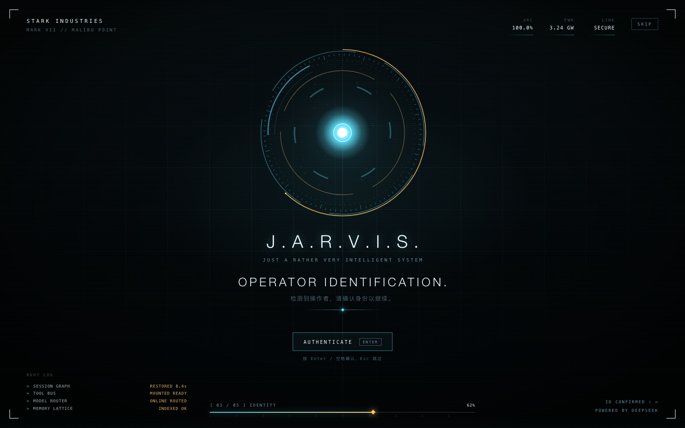
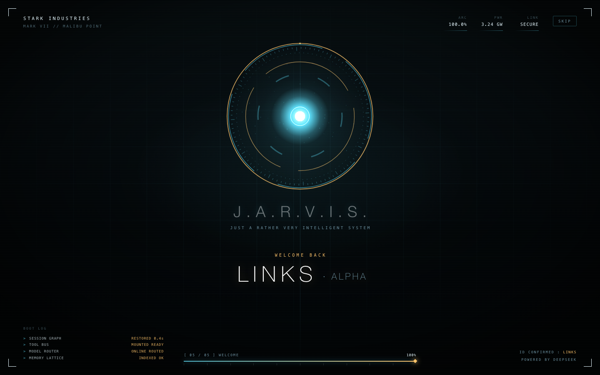

# dsh-jarvis-startup

DeepSeek Harness 的 JARVIS 式开机序列插件：冷启动时在整窗播一段约十秒的全息开机动画 ——
方舟反应炉点火 → HUD 构件展开 → 系统自检 → 身份核验 → 欢迎语 → 色散故障收束揭幕。

> 视觉参考《钢铁侠》里托尼·史塔克的装甲 HUD 与 JARVIS 的语气。**不含任何影视音视频素材**：
> 图形由 canvas 现场绘制，音效由 WebAudio 合成，台词由浏览器语音合成念出。

| 自检 | 身份核验 | 欢迎 |
|---|---|---|
|  |  |  |

## 播放序列

| # | 阶段 | 主文案 | 中文副文案 | 交互 |
|---|---|---|---|---|
| 0 | 点火 | 反应炉亮起，`J.A.R.V.I.S.` 逐字浮现 | — | — |
| 1 | `[ 01 / 05 ] POWER UP` | `GOOD EVENING, SIR.` | 晚上好。动力核心与语音链路已就绪。 | 自动 |
| 2 | `[ 02 / 05 ] DIAGNOSTICS` | `INITIALIZING SYSTEMS.` | 正在加载内核模块、会话图与工具总线。 | 自动 |
| 3 | `[ 03 / 05 ] IDENTITY` | `OPERATOR IDENTIFICATION.` | 检测到操作者，请确认身份以继续。 | 按 Enter / 空格或点 **AUTHENTICATE** |
| 4 | `[ 04 / 05 ] CLEARANCE` | `IDENTITY CONFIRMED.` | 名字 · CLEARANCE 等级 | 自动 |
| 5 | `[ 05 / 05 ] WELCOME` | `WELCOME BACK` / `LINKS · ALPHA` | — | 自动 |

1× 速度下全程约 10.6 秒；右上角 **SKIP**、Esc 可随时跳过。

## 功能

- **全息 HUD**：环形反应炉（多层刻度、反向旋转、扫描弧、粒子、辉光）、四角括号、顶部状态
  （ARC / PWR / LINK）、左下启动日志、底部带刻度与进度头的进度条。
- **交互不是播片**：身份核验那一步会停下来等你按 Enter / 空格 / 点按钮；可以关掉，改成自动通过。
- **语音**：优先挑系统里的英式男声（Daniel、Arthur 一类），念四句台词；没有可用声音时静默，不影响动画。
- **音效**：点火扫频、阶段推进、核验确认、终幕和弦，全部用 WebAudio 现场合成。
- **液态玻璃**：底衬可换成半透明磨砂层，透过它能看到被糊掉的应用界面；玻璃不透明度、磨砂模糊、
  饱和度、背景模糊各自独立可调。
- **两套主题**：冰蓝反应炉（默认）与金色马克 III，只换主副色，版式一致；也可以直接指定任意主色。
- **三十余项设置**：身份、称呼、权限等级、主标题、副标题、欢迎语、每个阶段的中英文案、语速音调、
  配色、扫描线、速度、播放模式，都在设置页里改，即改即存。
- **尊重系统偏好**：`prefers-reduced-motion` 下不再播放运动，直接显示终幕并短暂停留后揭幕。
- **不会锁死黑屏**：运行时若加载失败（404、被拦、语法错），注入的兜底脚本 10 秒后无条件放行页面。

## 安装

### 插件管理器（推荐）

DSH 的 **插件** 页 → **添加插件** → 选择本目录（`jarvis_start_up`）。
或让 agent 用插件管理器安装本目录；安装后刷新页面即可。

### 命令行

```bash
dsh plugin --profile web add /绝对路径/jarvis_start_up
```

桌面端把 `web` 换成 `desktop`；部分版本会拒绝在终端操作 `desktop` profile，此时改用桌面端的
「插件」页安装。

装完 **重启 dsh web 或桌面端**，刷新页面就会看到开机序列；设置页里会多出一项
**「JARVIS 开机序列」**。

### 卸载

```bash
dsh plugin --profile web remove dsh-jarvis-startup
```

### 环境要求

| 项 | 要求 |
|---|---|
| 平台 | DSH `web` profile 或桌面端 |
| Node | >= 20 |
| 依赖 | 无（不需要 `npm install`，也没有构建步骤） |

> 与 `dsh-startup-screen` 同时安装时，两套开机动画都会盖住整窗，只会看到其中一套。
> 想用这一套，请在插件页里把另一套停用。

## 设置

设置页 →「JARVIS 开机序列」。带分类目录和常驻底部操作条；「保存并重播」会保存当前草稿、
清掉本次会话的播放标记并刷新页面，立刻看一遍。

### 播放

| 选项 | 默认 | 说明 |
|---|---|---|
| 启用 | 开 | 总开关 |
| 显示模式 | 每次会话 | `每次会话` / `每次刷新` / `每天一次` |
| 主题 | 冰蓝反应炉 | 金色马克 III 会把主副色对调；改过主色后不再接管 |
| 速度 | 1× | 0.4 – 2.5 倍 |
| 要求确认 | 开 | 身份核验是否等确认 |
| 允许跳过 | 开 | 是否显示 SKIP、是否响应 Esc |

### 身份与台词

| 选项 | 默认 |
|---|---|
| 身份名称 | `LINKS` |
| 称呼 | `SIR` |
| 权限等级 | `ALPHA` |
| 主标题 | `J.A.R.V.I.S.` |
| 英文副标题 | `JUST A RATHER VERY INTELLIGENT SYSTEM` |
| 欢迎语上方小字 | `WELCOME BACK` |
| 左上角第二行 | `MARK VII // MALIBU POINT` |

### 语音

语音开关、音色（自动 / 指定系统语音）、语速、音调、音量、开口前留白。默认语速 0.92、音调 0.78，
是刻意压慢压低的管家腔。

### 音效 / 液态玻璃 / 视觉

音效开关与音量；玻璃开关、不透明度、磨砂模糊、饱和度、背景模糊；主色、副色、故障色 A/B、扫描线。

## 结构

| 文件 | 作用 |
|---|---|
| `lib/index.js` | Host 半侧：三条路由（`splash.css` / `splash.js` / `config`）、`tapIndex` 注入首屏与兜底脚本、配置读写 |
| `lib/splash.js` | 动画运行时：时间线、canvas 反应炉、语音与音效、交互与退场 |
| `lib/splash.css` | HUD 版式、玻璃、扫描线、故障收束动画 |
| `lib/client.js` | 浏览器半侧：设置分区与面板、桌面端自举兜底 |
| `preview/index.html` | 本地预览页（不经过 DSH，直接开就能看） |
| `test/` | Host 路由/注入、运行时、Client 注册的冒烟测试 |
| `locale/` `docs/` `icon.svg` | 插件元数据、详情页与图标 |

配置落在 `~/.dsh/jarvis-startup.json`（或 `$DSH_HOME/jarvis-startup.json`）。

## 本地预览

```bash
open preview/index.html
```

预览页把配置直接写在页面里，`requireInteraction` 设为关，方便反复看整段动画。

## 测试

```bash
npm test
```

覆盖：路由注册与首屏注入、配置读写与夹取、运行时语法与关键路径、Client 分区注册与面板工厂。

## 免责声明

本项目是个人学习与娱乐性质的同人作品，与漫威、迪士尼及相关权利方没有任何关联，也未获其授权或背书。
项目内**不包含**电影片段、剧照、原声音轨或任何影视素材；J.A.R.V.I.S. 的名字与视觉风格仅作致敬。

## License

MIT © links