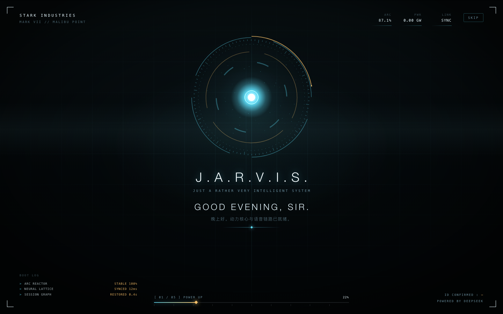

# dsh-jarvis-startup

DeepSeek Harness 的 JARVIS 式电影级 3D 全息开机序列插件：冷启动时在整窗播一段约十余秒的钢铁侠头盔 HUD 开机序列 ——
钛金面甲合拢展开与光学对焦 → 3D 神经网络方舟核心点火 → 头盔曲面 HUD 展开 → 系统自检与真实设备遥测 → 身份生物扫描核验 → 欢迎语 → 色散故障收束揭幕。

> 视觉参考《钢铁侠》与《复仇者联盟2》中的装甲面甲 HUD、3D 意识神经网络与 JARVIS 的管家语气。**不含任何影视音视频素材**：
> 全屏 3D 投影与 HUD 图形由原生 Canvas 2D 现场绘制，音效与低频反应炉底噪由 WebAudio 合成，台词由浏览器语音合成念出。

| 自检 | 身份核验 | 欢迎 |
|---|---|---|
|  |  |  |

## 播放序列

| # | 阶段 | 主文案 | 中文副文案 | 交互 |
|---|---|---|---|---|
| 0 | 面甲与点火 | 上下钛金面甲瞬闪展开 + 光学对焦，3D 神经网络核心点亮，`J.A.R.V.I.S.` 逐字浮现 | — | — |
| 1 | `[ 01 / 05 ] POWER UP` | `GOOD MORNING / AFTERNOON / EVENING, SIR.`（按本地时间自动切换） | 早上好 / 下午好 / 晚上好。动力核心与语音链路已就绪。 | 自动 |
| 2 | `[ 02 / 05 ] DIAGNOSTICS` | `INITIALIZING SYSTEMS.` | 正在加载内核模块、会话图与工具总线。 | 自动 |
| 3 | `[ 03 / 05 ] IDENTITY` | `OPERATOR IDENTIFICATION.` | 检测到操作者，请确认身份以继续。 | 按 Enter / 空格或点 **AUTHENTICATE** |
| 4 | `[ 04 / 05 ] CLEARANCE` | `IDENTITY CONFIRMED.` | 名字 · CLEARANCE 等级 | 自动 |
| 5 | `[ 05 / 05 ] WELCOME` | `WELCOME BACK` / `LINKS · ALPHA` | — | 自动 |

1× 速度下全程约 10.6 秒（开启语音时会在阶段切换与退场前自然等待当前台词播完，避免中途截断）；右上角 **SKIP**、Esc 可随时跳过并立即静音。

## 功能

- **真 3D 全息神经网络核心**：全屏 Canvas 3D 投影渲染——Fibonacci 球面神经节点群与动态突触连线、三层独立旋转的 3D 倾斜陀螺仪轨道环、120 格精密刻度、雷达扫描扇区与径向声波频谱环；语音播报时球体从赤道向两极掀起 3D 声波脉冲涟漪。
- **头盔面甲合拢与曲面 HUD 视场**：开场播放上下钛金面甲拉开与镜头失焦锁焦动效；画面左右渲染头盔内壁曲面测高弧、3D 景深全息尘埃粒子，以及带 `rotateY` 内弯透视的左右悬浮侧翼面板，支持鼠标 3D 空间视差。
- **真实设备遥测与低电量警示**：顶部与左右侧翼实时接入本地时钟、CPU 核心数、网络在线状态/延迟（RTT）与设备电池电量；未充电且电量低于 20% 时自动触发边缘琥珀红低电量警告脉冲。
- **交互式生物特征核验**：身份核验阶段展开双扫描弧、激光扫线与四角战术锁定框，并暂停等待按 Enter / 空格或点击按钮；也可在设置里关闭交互暂停，改为自动通过。
- **电影级语音与合成声场**：优先匹配系统里的英式男声（Daniel、Arthur 一类），按早/午/晚动态播报 5 句台词并防截断；WebAudio 现场合成面甲锁扣音、反应炉点火扫频、全程低频环境底噪（55Hz/110Hz 呼吸嗡鸣）、确认与终幕和弦。
- **三套电影主题与自定义配色**：内置 **冰蓝反应炉**（默认）、**金色马克 III** 与 **复联2 · 纯金意识球**（`ultron`）三套配色，也可单独指定任意主副色与故障色。
- **液态玻璃**：底衬可切换为半透明磨砂层，玻璃不透明度、磨砂模糊、饱和度与背景模糊各自独立可调。
- **三十余项设置**：身份、称呼、权限等级、面甲开场、3D 视差强度、神经网络密度、环境底噪、语音参数、配色与显示模式均可在设置页调整，即改即存。
- **尊重系统偏好与防黑屏兜底**：`prefers-reduced-motion` 下跳过动态直接展示终幕；若运行时加载失败，首屏注入的兜底脚本 10 秒后无条件放行页面。

## 安装

### 插件管理器（推荐）

DSH 的 **插件** 页 → **添加插件** → 选择本目录（`jarvis_start_up`）。
或让 agent 用插件管理器安装本目录；安装后刷新页面即可。

### 命令行

```bash
dsh plugin --profile web add /绝对路径/jarvis_start_up
```

桌面端把 `web` 换成 `desktop`；部分版本会拒绝在终端操作 `desktop` profile，此时改用桌面端的
「插件」页安装。

装完 **重启 dsh web 或桌面端**，刷新页面就会看到开机序列；设置页里会多出一项
**「JARVIS 开机序列」**。

### 卸载

```bash
dsh plugin --profile web remove dsh-jarvis-startup
```

### 环境要求

| 项 | 要求 |
|---|---|
| 平台 | DSH `web` profile 或桌面端 |
| Node | >= 20 |
| 依赖 | 无（不需要 `npm install`，也没有构建步骤） |

> 与 `dsh-startup-screen` 同时安装时，两套开机动画都会盖住整窗，只会看到其中一套。
> 想用这一套，请在插件页里把另一套停用。

## 设置

设置页 →「JARVIS 开机序列」。带分类目录和常驻底部操作条；「保存并重播」会保存当前草稿、
清掉本次会话的播放标记并刷新页面，立刻看一遍。

### 播放

| 选项 | 默认 | 说明 |
|---|---|---|
| 启用 | 开 | 总开关 |
| 显示模式 | 每次会话 | `每次会话` / `每次刷新` / `每天一次` |
| 主题 | 冰蓝反应炉 | `冰蓝反应炉` / `金色马克 III` / `复联2 · 纯金意识球` |
| 速度 | 1× | 0.4 – 2.5 倍 |
| 头盔面甲合拢开场 | 开 | 开场上下钛金面甲瞬闪展开与光学对焦 |
| 要求确认 | 开 | 身份核验是否等确认 |
| 允许跳过 | 开 | 是否显示 SKIP、是否响应 Esc |

### 身份与台词

| 选项 | 默认 |
|---|---|
| 身份名称 | `LINKS` |
| 称呼 | `SIR` |
| 权限等级 | `ALPHA` |
| 主标题 | `J.A.R.V.I.S.` |
| 英文副标题 | `JUST A RATHER VERY INTELLIGENT SYSTEM` |
| 欢迎语上方小字 | `WELCOME BACK` |
| 左上角第二行 | `MARK VII // MALIBU POINT` |

### 语音

语音开关、音色（自动 / 指定系统语音）、语速、音调、音量、开口前留白。默认语速 0.92、音调 0.78，
是刻意压慢压低的管家腔。

### 界面音效 / 液态玻璃 / 视觉与 3D 全息

- **界面音效**：音效总开关、反应炉环境底噪开关、音效音量。
- **液态玻璃**：玻璃开关、不透明度、磨砂模糊、饱和度、背景模糊。
- **视觉与 3D 全息**：3D 空间视差（0–2×）、神经网络密度（0.5–1.6×）、主色、副色、故障色 A/B、扫描线。

## 结构

| 文件 | 作用 |
|---|---|
| `lib/index.js` | Host 半侧：三条路由（`splash.css` / `splash.js` / `config`）、`tapIndex` 注入首屏与兜底脚本、配置校验与读写 |
| `lib/splash.js` | 动画运行时：全屏 3D 神经网络与头盔 HUD 渲染、文字解码、真实遥测、语音防截断与 WebAudio 声场 |
| `lib/splash.css` | 面甲开场、曲面 3D 悬浮侧翼、低电量警示脉冲、液态玻璃、扫描线与故障收束样式 |
| `lib/client.js` | 浏览器半侧：设置分区与面板、桌面端自举兜底 |
| `preview/index.html` | 本地预览页（支持一键切换三套电影主题并重播） |
| `test/` | Host 路由/注入、运行时、Client 注册的冒烟测试 |
| `locale/` `docs/` `icon.svg` | 插件元数据、详情页与图标 |

配置落在 `~/.dsh/jarvis-startup.json`（或 `$DSH_HOME/jarvis-startup.json`）。

## 本地预览

```bash
open preview/index.html
```

预览页默认开启语音并关闭交互暂停，右下角可直接切换「冰蓝反应炉 / 金色马克 III / 复联2 · 纯金」主题或点击重播。

## 测试

```bash
npm test
```

覆盖：路由注册与首屏注入、配置读写与夹取、运行时语法与关键路径、Client 分区注册与面板工厂。

## 免责声明

本项目是个人学习与娱乐性质的同人作品，与漫威、迪士尼及相关权利方没有任何关联，也未获其授权或背书。
项目内**不包含**电影片段、剧照、原声音轨或任何影视素材；J.A.R.V.I.S. 的名字与视觉风格仅作致敬。

## License

MIT © links
